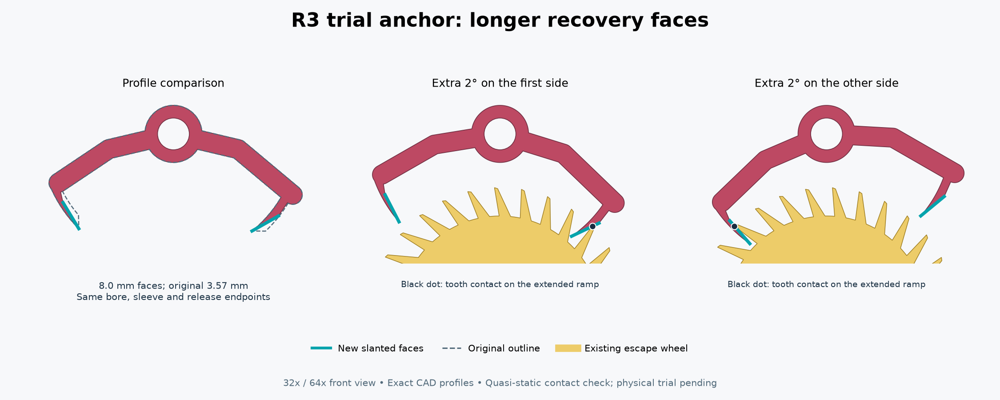

# R3 long-face anchor trial — 13 October 2026

The builder reports that the faceted case wheel lets the pendulum's relative position drift by roughly one or two degrees before rolling suddenly. The resulting deeper engagement can jam the escapement. This optional anchor provides a longer sloping contact path through that additional travel. **It has passed geometric checks; physical recovery from a sudden roll has not yet been tested.**

## What to print

For the current **32:1** clock, print **one [18_anchor_reversed_long_faces.stl](STL/18_anchor_reversed_long_faces.stl)**. The same file fits 64:1. For 16:1 only, use **one [18_anchor_forward_long_faces.stl](STL/18_anchor_forward_long_faces.stl)** instead. Do not print both anchors for one mechanism.

The anchor is a replacement for part 18. Reuse the existing escape wheel, pivot, spacers, frames, bridge, pendulum and fasteners. The pivot bore remains 8.35 mm; the plate remains 4 mm thick; the sleeve remains 12 mm outside diameter and 30 mm long. All axial positions are unchanged.

Print in the supplied orientation: **flat pallet/arm plate on the bed, sleeve pointing upward**, PLA, 0.4 mm nozzle, 0.2 mm layers, 5 walls and 100% infill. No supports. Remove any first-layer lip or strings from the working edges without rounding the slanted faces. Check that the sleeve turns freely on the existing pivot before reassembly.

The optional **[01_case_wheel_16384.stl](STL/01_case_wheel_16384.stl)** is the further rim refinement discussed after the 1,536-segment version. Print **two** to replace both drum wheels. It has 16,384 perimeter segments, approximately **0.0476 mm** between vertices, with the same 248 mm diameter and mounting features. The source deliberately bypasses ordinary mesh simplification, and the exported segment count is checked. Binary STL coordinate quantization is included in the mesh check; the ideal chord error alone is not a prediction of printed roundness.

Use the established wheel profile, without an outside brim on the 256 mm bed. The earlier suggested Bambu Studio starting settings remain Resolution 0.001 mm and Arc fitting on. These are not a tested guarantee that the sliced perimeter will retain every CAD detail. Avoid simplifying the imported mesh. The two different rim versions have distinct filenames: the standard R3 `01_case_wheel.stl` remains the 1,536-segment file.

## Face geometry



Both straight faces are now **8.0 mm long**, compared with **3.57 mm** on the original anchor. Their release endpoints are retained. The faces turn 30 degrees toward the original locking-arc tangents, making a gentler ramp. The former locking arc is replaced by a relieved connection into the existing arm. Extending the original face angle alone caused a neighbouring tooth to catch the entry pallet in the geometric trial; the changed angle avoids that interference within the checked range.

This changes the escapement from the original deadbeat locking geometry to **recoil geometry**: an engaged tooth may turn the escape wheel a little backward as the pendulum travels farther into engagement, then forward again on its return. In the checked range, the tooth's ideal frictionless force on the ramp acts toward release. Driving torque, friction, backlash and the coupled motion of the carrier and pendulum will determine whether the physical clock recovers as intended. The variant is not guaranteed against every jam or arbitrarily large disturbance.

## Replacing part 18

1. Rest the clock securely and remove the front case wheel to expose the mechanism. Keep loose ballast from spilling while opening it. Mark the pendulum clamp's current angle relative to the anchor sleeve as an initial reassembly reference.
2. Remove bridge 22 from its two posts, then slide front spacer 21 off the anchor pivot. Loosen the pendulum clamp screw and slide the pendulum off the anchor sleeve.
3. Remove the front frame's three mounting screws and lift the front frame off the pivot tips. Retain the loose gear spacers in their original positions; the existing build guide and pivot sheets still give the correct stack.
4. Slide the old anchor off pivot 19, leaving **rear spacer 20** in place. Fit the matching long-face anchor with its pallet plate toward the escape wheel and its sleeve toward the front frame, exactly as the old one was fitted.
5. Refit the front frame, pendulum, **front spacer 21**, and bridge 22. Rear-to-front anchor stack remains **20 → 18 → 21 → bridge 22**; the sleeve passes through the front frame and the pendulum clamps around it. The new part needs no extra washer or changed post.
6. With the case still open, apply light hand torque in the usual running direction and set the pendulum clamp for even release on both sides. Check a normal swing first, then gently let it travel a little farther in each direction while keeping the drive light. Some escape-wheel recoil is expected. Stop forcing the mechanism if a tooth catches.
7. Refit the front case wheel and try the same incline and ballast used previously. Trying the smoother wheels and then the new anchor separately will make their effects easier to identify.

## Checks and limits

The [machine-readable results](checks.json) cover 1,201 positions in each of four contact cycles: the original -2° to +8° anchor excursion; a -2° beat shift; a +2° beat shift; and an excursion extended to **-4° to +10°**. These are CAD anchor angles in the original forward convention, not pendulum-to-vertical setup instructions. The 32x/64x pair is reflected together and checked in its actual handedness.

- Every sampled leading tooth contact stays on a straight face. At the deepest checked engagement, at least **1.85 mm** of face remains before the deep end.
- Full finite-width tooth profiles have no material intersections. The nearest other tooth stays at least **0.67 mm** clear over the checked cycles.
- Each cycle has two pallet changes and a net advance of one 12-degree tooth pitch. A tick and a tock still give the same average case advance as before.
- The contact derivative has the restoring sign on both pallets. This checks the ideal force direction, not the available physical impulse or the absence of frictional sticking.
- The actual 3D anchor clears the other assembled parts at 61 cycle positions for each of 16x, 32x and 64x. The mounting sleeve matches the existing part.
- All three trial STLs are connected and watertight. Wheel features inside radius 122 mm are retained, and the exported outer rim has 16,384 segments.

These are rigid, quasi-static checks. They do **not** model an instantaneous jump, impact, print tolerances, elastic deflection, friction or gear backlash. Physical trial remains necessary. The standard anchor and existing guide are retained unchanged for comparison.

From the R3 source directory, regenerate with:

```sh
python check_long_face_anchor.py
```

Dependencies are the normal R3 CAD requirements plus Matplotlib for the drawing. Source: [long_face_anchor.py](../../source/long_face_anchor.py), [check_long_face_anchor.py](../../source/check_long_face_anchor.py). MIT license, as in the main project.
