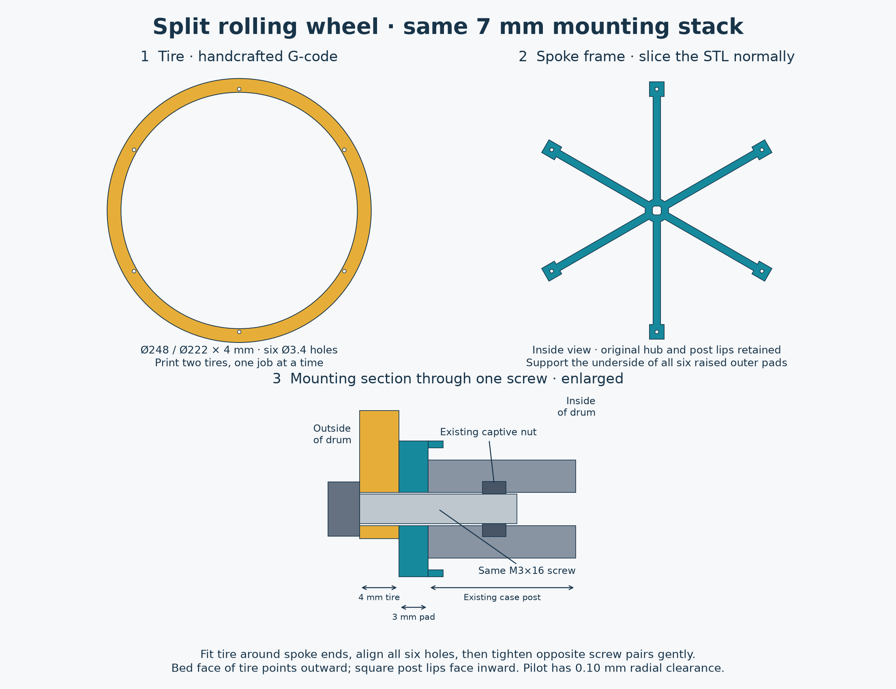
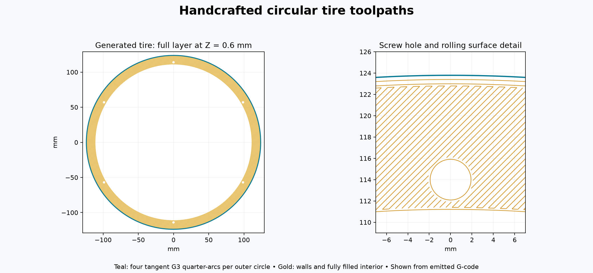

# Split wheel: circular G-code tire and sliced spoke frame

**Current lightweight trial:** the [wide zigzag tire](wide-zigzag/README.md) restores this tire's 13 mm radial width with open ribs and solid screw seats. Bambu Studio estimates **1 h 14 min / 14.44 g**, versus **3 h 16 min / 48.28 g** for this solid wide tire. Same spoke frame and hardware. Physical stiffness and rolling remain untested. The earlier [2 mm-wide tire](narrow-five-pass/README.md) was printed and reported too flimsy on 14 October.

Optional R3 experiment, 13 October 2026. Replaces each complete case wheel with a **4 mm solid tire** and a **spoke frame**. The original axle, six case posts, captive nuts and twelve M3×16 case screws are reused. Fits the existing 16:1, 32:1 and 64:1 drum assemblies without widening.

**CAD and emitted-toolpath checks pass; Bambu Studio loads the sliced file. Physical printing and improved rolling have not yet been confirmed.** This folder is separate from the standard wheel files and ratio print kits.



## Print these

| File | Complete drum quantity | How to print |
|---|---:|---|
| [01_tire_248x4_P1S_PLA.gcode.3mf](GCODE/01_tire_248x4_P1S_PLA.gcode.3mf) | 2 | Open as an already sliced job. Print one tire per plate/job; **do not reslice**. |
| [01_case_spider_for_4mm_tire.stl](STL/01_case_spider_for_4mm_tire.stl) | 2 | Slice normally, supplied orientation, with supports under the six raised outer pads. |

The [raw G-code](GCODE/01_tire_248x4_P1S_PLA.gcode) is the same job as the sliced 3MF, **not an additional part**. No tire STL is supplied: the rolling surface is generated directly as circular commands. The 3MF contains toolpaths rather than a resliceable mesh.

Print one tire and one spoke frame first to check fit and seating, then repeat for the other side. Both drum wheels need replacement for the final rolling test. Do not add these tires over the old complete wheels.

## Tire job and printer setup

This is a **P1S-specific** job derived from the uploaded `01_case_wheel.gcode.3mf`, using a **0.4 mm nozzle, Bambu PLA Basic profile, 1.75 mm filament and Textured PEI Plate**. Printing temperatures are **220 °C nozzle / 55 °C bed**, with flow ratio **0.98**. Startup retains the supplied profile's purge, wipe, homing, vibration check and bed-leveling sequence; the purge briefly uses 250 °C, just as in the supplied job. The stock textured-plate Z adjustment is retained.

The job selects **T0 / AMS slot 0**, the first filament in the uploaded job. Have PLA in that selected slot, or deliberately map the job's first filament to your intended PLA slot in the print dialog. The inherited unused ASA/ABS entries in the project metadata do not print. Changing sidebar settings on an already sliced job does not regenerate its temperatures or toolpaths. Use this file with the specified P1S setup, at normal 100% speed.

Open the sliced 3MF in Bambu Studio and confirm a single annulus, six holes and **20 layers / 4.00 mm**. Bambu Studio 02.05.00.66 displayed approximately **3 h 16 min / 48.28 g**, including its interpretation of priming; the generator's body-only estimate is **48.18 g / 15.90 m**. These are estimates, not measured print times or masses. No print has been started automatically.

The tire needs no supports or brim. Allow the large, thin ring to cool flat on the bed before removing it.

## How the tire is generated

- Nominal **248 mm OD, 222 mm ID, 4 mm thickness**. Six **3.4 mm clearance holes** on a **228 mm bolt circle**, at 30°, 90°, 150°, 210°, 270° and 330°.
- **Twenty 0.2 mm layers**, fully filled with alternating 45°/135° raster paths. No sparse interior. Three walls at the rolling edge; one inner-bore wall and one wall around each screw hole preserve fill space in the narrow webs.
- The outside of each layer is **four tangent G3 quarter-arcs about one center**, written to five decimal places. No STL facet fitting. Inner contour and screw holes also use circular arcs.
- First-layer material boundary shrinks by **0.15 mm radially**, tapering to **0.075 mm on layer 2**, then zero. This reduces the OD and enlarges the ID and holes on those layers. It compensates the bead boundary; it is separate from bed Z adjustment.
- Outside wall **25 mm/s on layer 1, 40 mm/s thereafter**, acceleration 500 mm/s². Solid fill uses 30/60 mm/s and deposition remains below 6 mm³/s. The auxiliary fan is off for more symmetric cooling; part fan is off for layer 1, then on.
- The seam advances about **137.51° per layer**, avoiding one ridge across the full tire width. The outer wall finishes each layer. This is a conventional seam, not a scarf or seamless spiral.
- Bead-volume calculation uses the rounded-rectangle cross-section, 0.98 flow ratio and relative extrusion. Travels retract 0.8 mm and lift 0.4 mm. The machine XY center is **128,126**, matching the supplied profile's **0,2 extruder offset** and model center 128,128.



## Slice the spoke frames

Keep the supplied orientation: broad spoke undersides on the bed, post locating lips facing upward. Use PLA, 0.4 mm nozzle, 0.2 mm layers, **3 walls, 5 top/bottom layers and about 30% infill** as a starting point. Paint/enforce build-plate supports under **all six raised outer mounting pads**, whose undersides start 4 mm above the bed. Normal/snug supports and a normal removable interface are appropriate; inspect the sliced preview to ensure all six pads are supported. The axle cross-hole retains the original short printable span.

Remove supports and clean the six seating faces flat. Avoid sanding the rolling surface to remove support scars: the tire itself has no supports. The frame's approximate print envelope is **216.3 × 241.8 × 12 mm**; keep it at 100% scale. A large outside brim is unnecessary and may exceed the bed.

The tire seats around the spoke ends: **221.8 mm pilot diameter inside a 222.0 mm tire bore**, giving 0.10 mm nominal radial clearance. This is a locating slip fit, not a press fit. Printed fit can differ; clear any first-layer burrs locally on the frame before assembly.

## Assemble

1. Remove one original case wheel while supporting the clock mechanism and case posts. Keep its six case screws and its axle retaining screw/nut.
2. Place a cooled tire with its **bed face outward**, away from the clock's interior. Fit the new frame into its central opening, with the **six square post locating lips facing inward**. The tire's upper face meets the undersides of the six raised pads.
3. Align the six holes. Each existing **M3×16** case screw goes from outside through **4 mm of tire + 3 mm of pad**, then into the existing case post's captive nut. This preserves the original **7 mm clamped stack**. No extra nut or washer belongs between tire and frame.
4. Start all six screws loosely. Center the tire with an even clearance around the six spoke-end pilots, then snug opposite pairs gradually. The 0.10 mm locating clearance permits some eccentricity; inspect the rim while rotating the assembly and adjust before final tightening. Tighten enough to seat the faces, without bowing the tire.
5. Refit the square axle and its original retaining screw exactly as in the main guide. Hub height, axle cross-hole and post seating planes are unchanged.
6. Repeat at the other end. Check both tires are flat, seated and concentric before the rolling test. The new wheel is still Ø248 mm, so the main guide's axle, spacers and mechanism assembly remain applicable.

The mounting diagram enlarges the screw stack; its post is shortened and nut pocket simplified for clarity.

## What the uploaded slice actually showed

The supplied file has **Resolution = 0.001 mm and arc fitting enabled**. Its long perimeter commands are mostly **G3 arcs**, not long straight facets. For example, layer 2 contains **59 G3 arcs and 21 G1 moves** around the outside; command lengths range from approximately **0.484 to 81.526 mm**, but the calculated path radius stays between **123.789284 and 123.790546 mm**: only **0.001261 mm peak-to-peak**. With its 0.42 mm outer-wall bead, that corresponds to a nominal surface radius near 124 mm.

Across all **35 layers carrying the rim**, the sampled commanded radial range is at most **0.001977 mm within a layer**. The first layer also has intentional elephant-foot compensation. Measurements use the actual machine-coordinate center, including the 2 mm extruder offset. See [per-layer results](source-rim-analysis.json) and the reproducible analyzer below. The original uploaded job is not redistributed.

Unequal command lengths in preview therefore do not establish comparable flats in the intended surface. Actual visible facets may involve the preview's rendering or the printer's motion, extrusion, seam, cooling and dimensional behavior; this inspection does not isolate their physical cause. The split design gives us a controlled circular path, slower perimeter motion and a replaceable tire. **It cannot guarantee a perfectly round printed wheel**, and assembly eccentricity or a warped ring could outweigh the small numerical path improvement.

## Validation and regeneration

[dimensions.json](dimensions.json) records the connected, watertight frame, unchanged hub, disjoint tire/frame geometry and retained screw engagement. [gcode-checks.json](gcode-checks.json) comes from parsing the emitted file independently: all 20 layer heights, circular commands, extrusion mode, build area, excluded bed corner, six open holes and flow bounds pass. Nominal bead footprints cover over 99.8% of sampled layer regions, with no residual void containing a 0.12 mm radius disc. This is a geometry diagnostic, not a porosity or firmware simulation. Bambu Studio preview has also been checked; no physical print is claimed.

From the repository root, with `source/requirements-split-tire.txt` dependencies installed:

```sh
python designs/rolling-timer-r3/source/split_tire.py
python designs/rolling-timer-r3/source/split_tire_gcode.py
python designs/rolling-timer-r3/source/check_split_tire.py
python designs/rolling-timer-r3/source/draw_split_tire.py
python designs/rolling-timer-r3/source/analyze_sliced_rim.py path/to/01_case_wheel.gcode.3mf --output report.json
```

The CAD command imports the existing R3 builder and regenerates the unchanged baseline geometry too. The G-code generator uses the supplied machine templates in `printer/`; editing those requires understanding the P1S startup sequence. They include intentional service-area moves outside ordinary print bounds. The independent bounds check applies to the generated tire body; startup/end sequences are retained from the supplied P1S slice. Bambu's [configuration loader](https://github.com/bambulab/BambuStudio/blob/master/src/libslic3r/Config.cpp) requires a full settings block for preview, so serialized profile comments are included even though this file is already sliced.

Design and generator code: MIT; see the repository license. Bambu printer-profile templates originate from the supplied Bambu Studio export.
