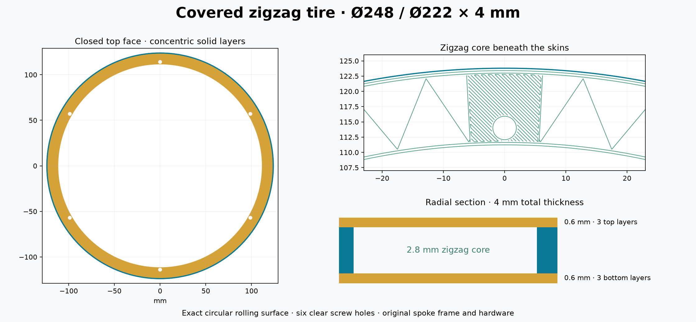

# Covered zigzag tire — three solid layers on each face

This version closes the wide zigzag tire with **0.6 mm bottom and top skins**, as requested for torsional stiffness. Both faces use **three fully filled concentric layers** at 0.2 mm layer height. The **4 mm total thickness**, Ø248 outside diameter, Ø222 inside diameter, six screw holes and all mounting parts are unchanged.

Bambu Studio preview estimates **1 h 54 min and approximately 24.5 g per tire**. The earlier open zigzag version displayed 1 h 14 min / 14.44 g; the solid wide tire displayed 3 h 16 min / 48.28 g. The closed version therefore takes approximately 42% less time and half the material of the original solid tire. These are estimates; physical torsional stiffness, bridging quality and loaded roundness remain to be tested.



## Layer structure

| Layers | Height range | Structure |
|---|---|---|
| 1–3 | 0–0.6 mm | Solid concentric bottom skin |
| 4–17 | 0.6–3.4 mm | 0.5 mm zigzag web, three outer walls, two inner walls and solid screw seats |
| 18–20 | 3.4–4.0 mm | Solid concentric top skin |

The skins join the circular walls, ribs and six screw pads. All six Ø3.4 mm screw holes stay open through every layer. This produces a closed section around the ring, with enclosed triangular cells between ribs, without filling the entire 13 mm radial width solid.

The first top layer prints at **25 mm/s** over the core cells with full part cooling. Each uninterrupted skin path starts on a solid mounting pad or a bore wall. The generator uses concentric circular arcs clipped around the screw holes; subsequent top layers cover the first roof. The maximum unsupported arc length is approximately **11.8 mm**, measured in [checks.json](checks.json). Geometric span checks cannot guarantee physical bridging quality.

## Files and printing

Print **two tires**, one per job, using [01_tire_248x4_covered_zigzag_P1S_PLA.gcode.3mf](GCODE/01_tire_248x4_covered_zigzag_P1S_PLA.gcode.3mf). Open it directly in Bambu Studio as an already sliced job: **do not reslice**. The raw `.gcode` is the same job in another container, not an extra part.

Use **P1S / 0.4 mm nozzle / 1.75 mm PLA / Textured PEI Plate**, normal 100% speed. **Enable Bed leveling in the print dialog.** The startup follows that checkbox. The retained profile uses a **220 °C nozzle, 55 °C bed and 0.98 flow ratio**. It selects **T0 / AMS slot 0**; load PLA there or map the first filament to the intended PLA slot. Changing sidebar settings does not modify this already sliced job.

The tire prints flat without supports or brim. Let it cool before lifting it. **Reuse your existing split-wheel spoke frames, case posts, axle, nuts and M3×16 screws.** The included [01_case_spider_for_4mm_tire.stl](STL/01_case_spider_for_4mm_tire.stl) is byte-identical to the earlier frame, supplied only if it has not yet been printed. The old one-piece case wheel cannot serve as this frame.

For an unprinted frame, use its supplied orientation with post lips upward, 0.2 mm layers, 3 walls, 5 top/bottom layers and about 30% infill. Support the undersides of all six raised outer pads; remove supports and clean the seats flat.

## Assembly

1. Seat the tire around the spoke ends, **bed face outward** and frame post lips inward. See the unchanged [assembly drawing](../assembly.png).
2. Start the six **M3×16** screws through **4 mm tire + 3 mm frame pad** into the case posts' captive nuts.
3. Center on the existing pilots, which have 0.10 mm nominal radial clearance. Snug opposite screw pairs gradually without distorting the rim.
4. Refit the original axle retaining screw. Repeat on the other side and check free rolling under the clock's weight.

## Verification and source

The outer rolling surface remains four tangent G3 quarter-arcs per layer at 40 mm/s with 500 mm/s² acceleration (25 mm/s on layer 1). Its seams remain distributed between layers. Edge compensation remains 0.15 / 0.075 / 0 mm on layers 1 / 2 / 3 onward. Concentric skin widths are calculated to fill the available span with the nominal bead overlap; paths avoid the bore walls. The first roof starts at layer 18, Z = 3.6 mm.

[checks.json](checks.json) records independent parsing of the emitted G-code: solid coverage of all six skin layers, core continuity, roof support and span checks, clear bores, bed bounds, extrusion rates and hardware clearance. The CAD validation represents one connected solid with enclosed core cells. [preview-check.json](preview-check.json) records the Bambu Studio preview and file hash. No print was sent automatically.

Regenerate from the repository root with `source/requirements-split-tire.txt` installed:

```sh
python designs/rolling-timer-r3/source/covered_tire.py
python designs/rolling-timer-r3/source/check_covered_tire.py
```

The shared printer templates remain in the parent `printer/` directory. The open zigzag, solid wide and narrow trials remain separately named. Design and generator code are MIT licensed.
