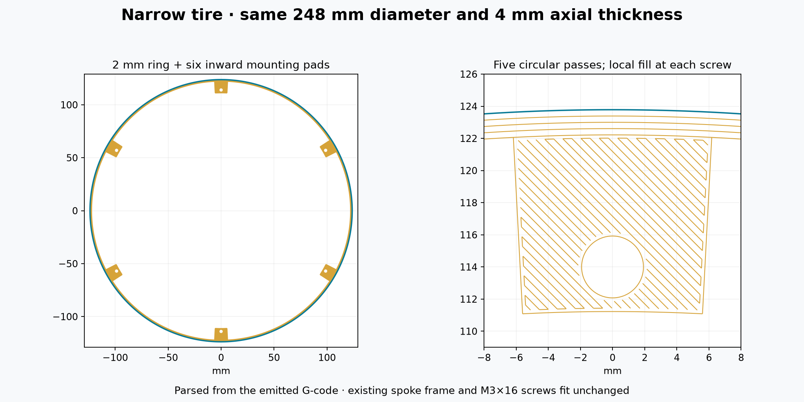

# Narrow tire — five circular passes per layer

The tire now has a **2 mm radial wall** between its **248 mm OD and 244 mm ID**, with six inward mounting pads. Its **4 mm axial thickness** is unchanged. All twenty 0.2 mm layers have **five uninterrupted concentric circles** around the rolling ring. Only the six mounting pads have local solid infill.

Bambu Studio 02.05.00.66 preview estimates **1 h 5 min and 11.34 g per tire**, including 7 min 12 s preparation. The earlier 13 mm-wide tire displayed 3 h 16 min and 48.28 g: approximately **67% less time and 76.5% less material**. These are software estimates; no physical printing or improved roundness is claimed.



## Print list

| File | Complete drum quantity | Action |
|---|---:|---|
| [01_tire_248x4_2mm_ring_P1S_PLA.gcode.3mf](GCODE/01_tire_248x4_2mm_ring_P1S_PLA.gcode.3mf) | 2 | Open as an already sliced job; print one at a time. **Do not reslice.** |
| [01_case_spider_for_4mm_tire.stl](STL/01_case_spider_for_4mm_tire.stl) | 2 | Slice normally. **Identical to the previous split-wheel frame: reuse it if already printed.** |

The raw `.gcode` is an alternative container for the same tire job, not another part. The narrow tires replace the previous wide tires, not the spoke frames. Original one-piece wheels cannot be used as the spoke frames.

The existing axle, six case posts, all captive nuts and M3×16 screws are reused. The six holes remain Ø3.4 mm on the same Ø228 mm bolt circle. Inward pads reach radius 111 mm to retain the original locating fit and screw bearing area; between pads, the ring begins at radius 122 mm.

## Printer and assembly

Use **Bambu Lab P1S, 0.4 mm nozzle, 1.75 mm PLA, Textured PEI Plate**, with normal 100% speed. The job retains the supplied PLA profile's **220 °C nozzle, 55 °C bed and 0.98 flow ratio**, plus its startup/ending sequence. It selects the original **T0 / AMS slot 0** filament: put PLA there or map the first filament to your intended PLA slot in the print dialog. Changing sidebar settings does not alter this already sliced job. No printer job has been sent automatically.

The tire prints flat without supports or brim. Let it cool on the bed before lifting it. The ring is substantially more flexible than the wide version; check for deflection between the pads under the clock's actual weight before judging its rolling performance. Geometric checks do not establish its loaded roundness.

For the unchanged spoke frame, keep its supplied orientation, with post lips upward. Use 0.2 mm layers, 3 walls, 5 top/bottom layers and about 30% infill. Support the undersides of **all six raised outer pads**, then remove supports and clean the seats flat.

1. Seat the tire around the spoke ends, with its **bed face outward** and the frame's **post lips inward**.
2. Align the six holes and start all six existing **M3×16** screws loosely. Each passes through **4 mm tire pad + 3 mm frame pad**, into the case post's captive nut.
3. Center the tire on the six inward pilots (0.10 mm nominal radial clearance), then snug opposite screw pairs gently. Avoid distorting the narrow ring by overtightening.
4. Refit the original axle retaining screw and repeat on the other side. No axle, post, spacer or screw-length change is needed.

## Circular paths and compensation

Each circle is four tangent G3 quarter-arcs. The outside pass stays at **40 mm/s** with 500 mm/s² acceleration; the four inner passes use 60 mm/s. All five use 25 mm/s on layer 1. Seams rotate between layers. The rolling ring has no raster infill.

First-layer edge compensation is retained: **0.15 / 0.075 / 0 mm** on layers 1 / 2 / 3 onward. To fit exactly five overlapping beads into the compensated ring, their width is approximately **0.374 / 0.404 / 0.434 mm** respectively. Nominal bead overlap is derived from the rounded bead cross-section at 0.2 mm layer height. The six pads retain small local perimeters and solid raster fill; these join the inner ring pass without reaching the outer rolling surface.

[checks.json](checks.json) records independent parsing of the emitted commands: five complete ring circles on all 20 layers, clear bores, build-area bounds, dense connected bead coverage and unchanged screw/frame compatibility. [preview-check.json](preview-check.json) records the inspected Bambu Studio file's hash and estimates. Physical stiffness, dimensional fit and rolling performance remain to be tested.

To regenerate from the repository root with `designs/rolling-timer-r3/source/requirements-split-tire.txt` installed:

```sh
python designs/rolling-timer-r3/source/narrow_tire.py
python designs/rolling-timer-r3/source/check_narrow_tire.py
```

The shared machine templates remain in the parent `printer/` folder. The earlier wide tire is preserved separately for comparison. Design and generator code are MIT licensed; see the repository license.
