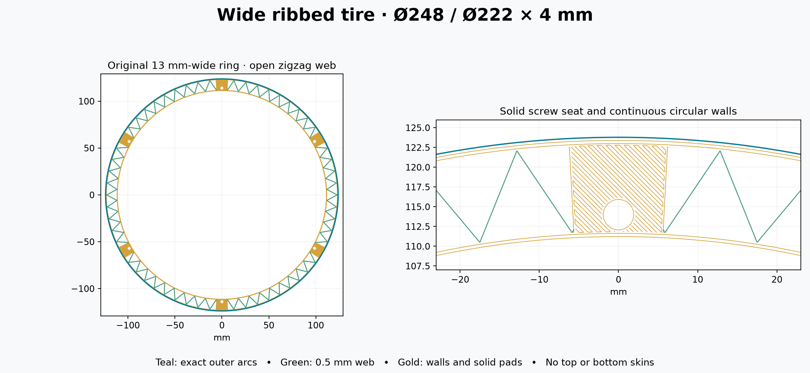

# Wide tire with open zigzag ribs

This version responds to the 14 October report that the 2 mm-wide printed ring was too flimsy. It restores the original **248 mm OD, 222 mm ID and 4 mm axial thickness**, while removing most of the interior material.

Bambu Studio preview estimates **1 h 14 min and 14.44 g per tire**, including 7 min 12 s preparation. The solid wide tire displayed 3 h 16 min and 48.28 g: approximately **62% less time and 70% less material**. Compared with the narrow trial, this uses about 3.1 g more PLA and 9 minutes more time. Estimates are software predictions; physical stiffness and loaded roundness still need testing.



## What is printed

- **Three continuous circular outer passes** form the rolling rim; **two inner passes** form the inner ring. Normal-layer radial wall thicknesses are approximately 1.23 mm outside and 0.86 mm inside.
- A **0.5 mm-wide zigzag web** joins those walls across the full 13 mm radial envelope. Its vertices are spaced 3 degrees apart, making a 6-degree full repeat. The same ribs repeat through all twenty layers.
- **Six solid mounting pads** surround the original Ø3.4 mm screw holes on Ø228 mm PCD. Local dense fill is confined to these pads.
- The triangular spaces are **open on both axial faces**: no top/bottom skins, roofs or bridging. The ribs and circular walls rise directly from the bed.

This separates the inner and outer walls to provide a wider structure while using relatively little plastic. No stiffness multiplier or guaranteed rolling improvement is claimed.

## Print files

| File | Complete drum quantity | Action |
|---|---:|---|
| [01_tire_248x4_wide_zigzag_P1S_PLA.gcode.3mf](GCODE/01_tire_248x4_wide_zigzag_P1S_PLA.gcode.3mf) | 2 | Open as an already sliced job. Print one at a time; **do not reslice**. |
| [01_case_spider_for_4mm_tire.stl](STL/01_case_spider_for_4mm_tire.stl) | 2 | **Identical to the existing split-wheel frame. Reuse if already printed.** |

The raw `.gcode` is the same tire job in a different container, not another print. No new axle, case posts, spacers, screws or nuts are needed. The old one-piece case wheel is not a substitute for the split-wheel spoke frame.

Use **Bambu Lab P1S, 0.4 mm nozzle, 1.75 mm PLA, Textured PEI Plate**, normal 100% speed, and **enable Bed leveling in the send/print dialog**. The startup honors that checkbox. The job retains the supplied profile's **220 °C nozzle, 55 °C bed and 0.98 flow ratio**. It selects **T0 / AMS slot 0**; load PLA there or map the first filament to your intended PLA slot in the print dialog. Sidebar setting changes do not regenerate this already sliced job.

Print the tire flat without supports or brim. Let it cool before removing it. For an unprinted spoke frame, use its supplied orientation with post lips upward, 0.2 mm layers, 3 walls, 5 top/bottom layers and approximately 30% infill. Support the undersides of all six raised outer pads, remove supports, and clean the mating surfaces flat.

## Assembly

1. Seat the tire around the spoke ends, **bed face outward**, frame post lips inward. The existing [assembly drawing](../assembly.png) still applies to the screw stack.
2. Align the six holes. Start all six **M3×16** screws loosely through **4 mm tire pad + 3 mm frame pad** into the case posts' captive nuts.
3. Center the tire on the existing inward pilots (0.10 mm nominal radial clearance). Snug opposite screw pairs gradually without distorting the rim.
4. Refit the existing axle retaining screw and repeat on the other side. Check both tires for loaded deflection and free rolling before testing the escapement.

## Paths and checks

The outer surface retains four tangent G3 quarter-arcs per layer, **40 mm/s and 500 mm/s²**, with seams distributed between layers. Layer 1 uses 25 mm/s. Inner circular passes use 60 mm/s after layer 1; ribs use 50 mm/s. Edge compensation remains **0.15 / 0.075 / 0 mm** on layers 1 / 2 / 3 onward. Pad fill alternates direction; the web stays in the same position to support successive layers. Its nominal wall overlap is 0.24 mm.

The generic 10% sparse-infill metadata describes the approximate web density, not a resliceable recipe. All geometry is explicitly encoded in the supplied paths; the exact repeated web and solid pads determine the material use.

[checks.json](checks.json) records independently parsed arc centers, layer heights, extrusion rates, bed bounds, bore clearance, connected wall/rib/pad footprints, initial-layer support and unchanged hardware compatibility. [preview-check.json](preview-check.json) records the inspected Bambu Studio file hash and estimates. No print was sent automatically. Checks establish geometry and file consistency; the next physical trial will establish adhesion, stiffness and rolling behavior.

To regenerate with `source/requirements-split-tire.txt` installed, from the repository root:

```sh
python designs/rolling-timer-r3/source/ribbed_tire.py
python designs/rolling-timer-r3/source/check_ribbed_tire.py
```

The shared printer templates remain in the parent `printer/` directory. Original solid and narrow jobs remain separately named. Design and generator code are MIT licensed.
